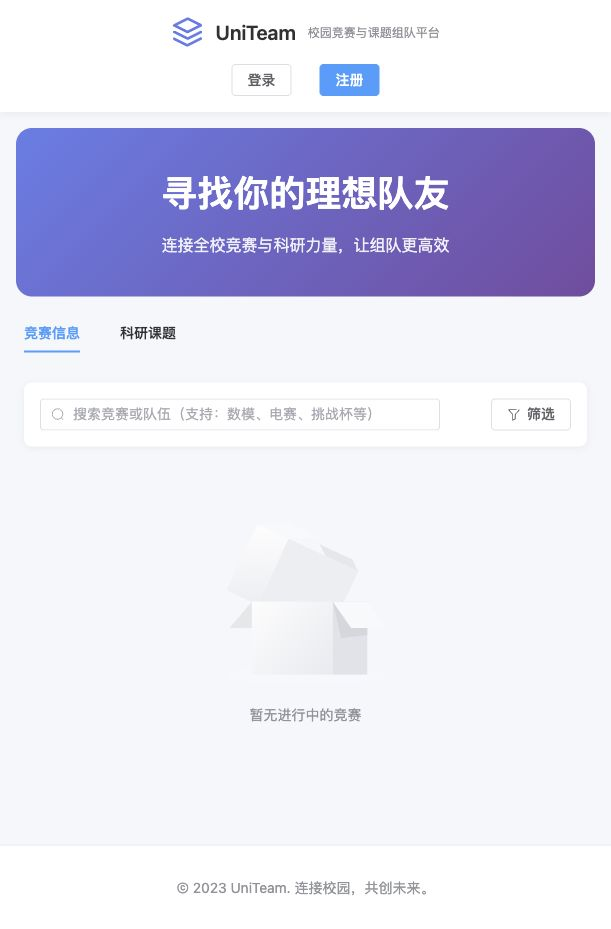

# UniTeam 校园竞赛与课题组队平台

面向希望参加竞赛、寻找课题伙伴的高校学生，尝试让同学通过专业、技能和招募需求找到互补的队友。

项目起于我对校园组队方式的观察：熟人组队很方便，但并不总能形成合适的分工；希望参赛的同学，也可能缺少接触其他专业伙伴的渠道。我借助 AI 设计和开发网站，尝试把这个问题做成可操作的产品原型。

本仓库从个人开发存档恢复，前后端均有业务实现。目前已验证前端资源打包，完整后端运行与用户流程仍需复核。



上图为 2026 年 10 月恢复后在本机打开的首页。后端与数据库未启动，因此没有竞赛数据；截图用于展示已有页面。

## 项目时间

| 时间 | 进展 |
| --- | --- |
| 2025 年 11 月 | 开始个人探索，时间根据作者本人陈述整理 |
| 2025 年 12 月 | 本次恢复的源码与配置，文件修改日期集中于这一时期 |
| 2026 年 10 月 24 日 | 恢复源码、整理配置与说明、验证前端资源打包 |

存档不含历史 Git 提交。文件修改日期不能确定各项功能的完成时间；本次整理也不代表项目在此时首次开发。

## 已有功能代码

- 竞赛与课题浏览、检索和详情展示。
- 创建队伍、设置招募需求和验证问题。
- 提交与撤销申请、队长审核、成员管理及招募状态处理。
- 人才库筛选、邀请、站内消息和申请通知。
- 高校邮箱注册流程、登录、个人资料与技能标签。
- 竞赛、用户、队伍、公告及统计管理页面。

以上是代码中的实现范围，完整流程和真实用户效果仍需验证。技能匹配采用标签筛选和排序，站内消息使用轮询。

## 个人工作与 AI 协作

我负责提出问题、定义产品方向，并借助 AI 推进页面、架构和业务代码的设计与开发。开发中使用 Gemini 3 辅助前端及架构设计，结合其他 AI 工具推进后端和功能完善。

后续，我加入校园内推进相近方向的项目组，并提出网站改进建议。本仓库整理的是个人开发存档，团队项目中的具体贡献另行说明。

## 技术与目录

前端使用 Vue 3、TypeScript、Vite、Element Plus、Pinia 和 Axios；后端使用 Java 17、Spring Boot 3.2、Spring Data JPA、MySQL、Redis 和 JWT。

```text
frontend/     页面、状态管理和前端接口
backend/      业务接口、服务、实体和数据访问
.env.example  本地环境配置参考
```

## 本地运行

### 前端

安装 Node.js 和 npm 后，在 `frontend` 目录执行：

```sh
npm ci
npm run dev
```

页面默认使用 `http://localhost:3000`，`/api` 请求代理到 `http://localhost:8080`。后端未启动时，需要数据的页面会显示空列表或请求错误。

### 后端

准备 JDK 17、Maven、MySQL 和 Redis，并授予数据库账户创建或访问 `campus_team` 数据库的权限。

将 `.env.example` 中的变量配置到终端环境或 IDE；Spring Boot 不会自动加载该文件。`DB_PASSWORD`、`JWT_SECRET` 必须设置，JWT 密钥至少 32 字节。两个 `BOOTSTRAP_ADMIN_*` 变量均配置时，才会初始化管理员。

在 `backend` 目录执行：

```sh
mvn spring-boot:run
```

后端默认监听 `8080`。数据库表由 JPA 按实体更新，原始数据库和用户数据未包含在仓库中。

## 恢复检查结果

2026 年 10 月 24 日，对当前存档进行了以下检查：

| 检查 | 结果 |
| --- | --- |
| 前端干净安装依赖 | 通过，使用锁文件安装 |
| 前端资源打包 `npx vite build` | 通过，Vite 5.4.21 |
| 首页浏览器预览 | 通过，已保存实际页面截图；未连接后端数据 |
| 类型检查 `vue-tsc --noEmit` | 未通过；`vue-tsc` 1.8.27 与 TypeScript 5.9.3 组合报错，尚未进入业务类型检查 |
| 后端编译与运行 | 本次未执行，本机缺少 JDK 与 Maven |
| 注册、组队、邀请等完整流程 | 本次未完成端到端验证 |

资源打包通过不能代替标准的 `npm run build`、后端测试或完整业务验证。

## 当前限制与后续工作

- 邮件发送逻辑尚未接通，开发版本把验证码写入后端日志。
- 成员页获取队长联系方式的接口用法需要修正。
- 队伍删除后的关联申请清理仍有待完成事项。
- 后端权限与边界处理需要继续检查，目前适合本地原型研究与展示。
- 内测人数、用户反馈、实际组队成效等尚无本次存档可核验的记录。

下一步优先恢复后端环境并验证一个完整组队流程，再让有组队需求的同学实际试用，观察他们如何判断队友是否合适。

## 本次归档整理

排除了 `node_modules`、`target`、上传样本和本地配置；数据库密码与 JWT 密钥改为环境变量，管理员初始化改为显式配置，并移除固定账户密码日志。这些是 2026 年恢复整理时的调整。
